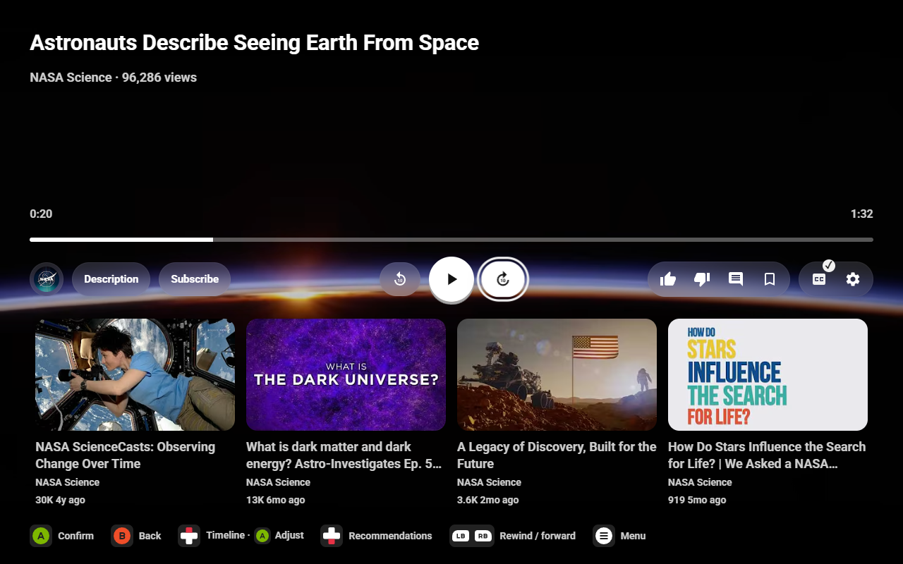
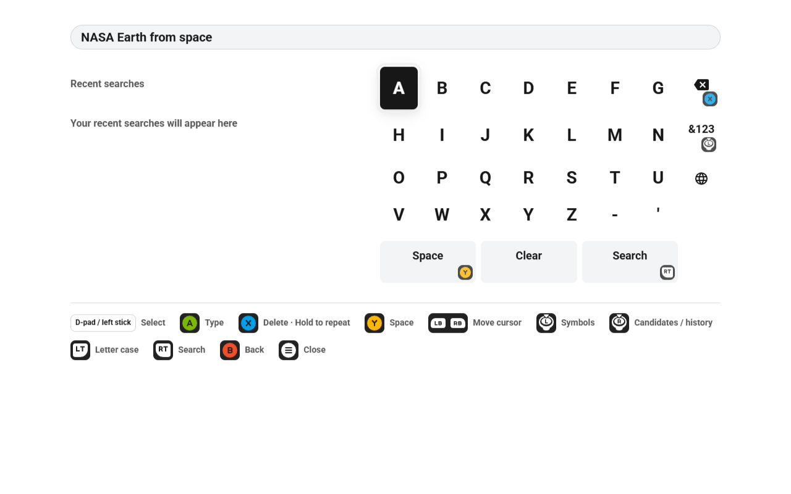

# YouTube Gamepad

[Microsoft Edge 商店安装](https://microsoftedge.microsoft.com/addons/detail/youtube-gamepad/epfikkcjfmfjhmkgolokdfcjkammbkij)

用手柄在 Chrome / Edge 中浏览 YouTube、观看视频和输入搜索内容。

数据 API 统一使用 GitHub 项目 [LuanRT/YouTube.js](https://github.com/LuanRT/YouTube.js)（18.1.0）执行请求与解析

操作逻辑参考 [wiliwili](https://github.com/xfangfang/wiliwili) 与其 Borealis 导航框架

[简体中文](#youtube-gamepad) · [English](#english)

### 安装

先下载本仓库 ZIP 并解压，或克隆仓库到本地。安装和使用无需 Node.js；下文的开发检查需要 Node.js。

1. Chrome 打开 `chrome://extensions`，Edge 打开 `edge://extensions`。
2. 运行 `npm ci` 和 `npm run build:extension`。打开开发者模式，选择“加载已解压的扩展”，选择生成的 `dist/` 文件夹。
3. 打开或刷新 https://www.youtube.com/，连接手柄，点击页面并按一次手柄按键。
4. 用方向键或左摇杆选择，A 打开视频，Start 打开快捷菜单。工具栏弹窗保留启用开关、连接状态和“更多设置”。快捷菜单中的“完整设置”也可进入设置页。

### 架构

- `gamepad.ts`：ISOLATED world 输入轮询、标准按键映射、死区、方向长按重复；只发送动作，不点击页面。
- `core.ts`：ISOLATED world 导航核心；维护选中项、按几何位置选择目标、处理弹窗范围和 Shadow DOM 提示层。输入归属和选中框显示由注入策略决定，不读取具体菜单或播放模块的状态。
- `navigation.ts`：独立的方向规则，参考 [js-spatial-navigation](https://github.com/luke-chang/js-spatial-navigation) 的 section 思路，代码独立编写；先在分区内寻找同一行列的目标，再按显式出口跨区。无需 React 或第三方运行依赖。
- `sites/youtube.ts`：集中管理 YouTube 选择器、视频/推荐/评论/播放状态读取、搜索同步和原生设置操作；界面接收数据快照，原生节点保留在适配层。通过 `createNavigationConfig(policy)` 接收协调层接口。
- `coordinator.ts`：管理模式、适配能力、设置和动作归属，连接站点与界面。`app/route-state.ts` 保存纯导航返回规则，`app/route-controller.ts` 负责路由监听和历史操作。
- `keyboard.ts`：按官方电视版已核对的布局定义字母页、数字页和键盘动作；不依赖官方混淆脚本。
- `menu.ts`：快捷菜单宿主、焦点与搜索入口；`search.ts` 负责文本编辑、拼音候选、键盘和搜索历史，原生操作通过端口请求。
- `watch.ts`：观看交互与数据刷新；`ui/watch-view.ts` 创建界面，`ui/watch-panels.ts` 管理说明和评论面板。Shadow 样式源文件为 `ui/menu.css` 和 `ui/watch.css`，由开发脚本生成 `ui/styles.ts`。
- `runtime.ts`：按模块登记监听器、定时器、动画帧、观察器和清理函数；销毁后清理浮层和历史包装，支持重新注入。
- `browse.js` / `browse.css`：主页外围导航；顶栏、侧栏和分类栏布局保留在 `browse.css`。公共配色、字体、圆角、间距和焦点反馈统一在 `ui/theme.css`，主页、快捷菜单、搜索和设置弹窗共同引用；搜索实时跟随 YouTube 明暗主题，视频控制层保留深色半透明背景。完整设置页与扩展工具栏弹窗使用最近一次 YouTube 明暗主题，尚未读取到网站主题时采用系统明暗偏好。
- `content.ts`：ISOLATED world 设置桥接，读取扩展存储；独立检测标准手柄并向后台报告连接状态。`inline-settings.ts` 在同一隔离环境中渲染快捷菜单内的设置，界面事件处理器直接保存固定设置项；页面消息不能提供任意存储键或设置值。
- `background.ts`：使用 `chrome.windows.update` 管理 F11 式窗口全屏；原窗口状态保存在 `chrome.storage.session`，页面跳转和后台休眠不会清除。只恢复扩展自己开启的全屏。
- `popup.html` / `popup.js` / `popup.css`：工具栏弹窗，提供启用开关、连接状态和更多设置入口。`options.html` / `options.js` / `options.css`：完整设置页，左侧分类、右侧内容，分为“常用”“画面与布局”“手柄与按键”“帮助与诊断”；窄屏分类显示在内容上方，修改后自动保存。
- `manifest.json`：声明两个执行环境中的脚本，只匹配 www.youtube.com。

设置面板 → chrome.storage → content.ts → 设置消息 → coordinator.ts → 输入层、导航核心与播放界面。
手柄 → gamepad.ts → 动作事件 → core.ts → 协调层 → 播放界面 / YouTube 适配。

模块职责、数据端口和输入优先级见 [ARCHITECTURE.md](ARCHITECTURE.md)。播放界面通过 `connect(port)` 读取数据快照并请求操作，通过 `sync()` 接收协调层的模式更新。菜单、原生弹窗、说明/评论面板按层消费动作，只有明确返回 `pass` 才允许继续分发。

`core.ts` 通过站点配置中的 `shouldShowSelection({ scope })` 回调决定是否显示选择框，不读取站点或播放界面状态。`watch.ts` 通过 `connect({ state, request, ... })` 接收只读状态快照与统一命令入口，模式、启用状态和导航锁由 `coordinator.ts` 管理，`sync()` 仅按当前状态渲染，不能回写模式。推荐切换、播放操作、设置、频道、评论及返回控制栏都经过 `request(type, value)`，共享禁用和导航锁检查。原生设置关闭后的焦点只由 `focus.ts` 的层级栈恢复，播放页不再保存第二份恢复目标。站点层不调用播放界面；协调层最后加载并完成接口注入。

MAIN world 脚本通过 Manifest V3 静态声明加载，避免手动插入脚本标签。窗口全屏由后台 service worker 控制，不读取标签敏感信息，无需 tabs 权限。

词库衍生数据采用 **CC BY-SA 4.0**，重新分发时须保留署名与授权信息，详见 [THIRD_PARTY_NOTICES.md](THIRD_PARTY_NOTICES.md)。独立编写的扩展代码采用 **MIT** 许可证，见 [LICENSE](LICENSE)；词库和第三方素材继续遵循各自的许可证。发布包包含代码许可证与第三方授权说明。

### 独立视频播放页

视频作为全屏背景，顶部展示标题、频道和观看次数；下方是独立进度条及频道头像、说明、订阅、快退、播放、快进、点赞、点踩、评论、保存、字幕、设置按钮。播放按钮居中放大，进度条上方左侧显示当前时间、右侧显示总时长。默认只露出部分推荐卡片，下键进入推荐区后展开完整卡片。视频内容、字幕和原播放器设置仍由 YouTube 提供。

- 上键唤出控制栏，默认选中播放按钮。按钮区左右移动，上键进入进度条，下键进入推荐。进度条未处于调整状态时，再按上键收起面板，回到纯播放。各区保留自己的选择，返回按钮区恢复之前的按钮。
- 进度条先按 A 开始调整，左右调整 10 秒；A 结束调整并保留进度条焦点，B 先退出调整，再按 B 回按钮区。直播或未知时长不执行固定进度跳转。
- 推荐区左右选择，A 使用原视频链接播放，B / 上键回按钮区。连续播放推荐后退出视频，返回最初的列表；刷新后不保留这段浏览记录。
- 设置使用原播放器菜单，B 从子菜单回主菜单，再关闭设置并恢复设置按钮。不会因关闭设置而退出视频。
- 评论在右侧面板展示，视频缩小到左侧。评论、回复及分页通过当前页面会话调用 YouTube.js 接口获取，不扫描或滚动原生评论区。上下逐条阅读，长评论先滚动完整正文，A 展开回复；加载更多按钮请求接口续页。加载中阻止重复请求，失败保留已有内容并支持重试；切换视频取消旧请求。每视频最多展示 100 条评论，每线程最多 100 条回复，全部线程共用 200 条回复预算。B 关闭并恢复评论按钮。当前不支持发表评论、发送回复和切换评论排序；读取速度与可用内容受网站接口影响。
- 控制栏在视频播放、无操作 5 秒后隐藏。暂停、推荐浏览、进度调整、功能面板和设置菜单打开期间保持显示。
- 关闭扩展或离开视频页后恢复原网站布局。

验证时需检查：默认推荐裁切及展开、进度区与按钮区焦点恢复、设置子菜单逐层返回、评论及回复读取、连续推荐播放后的列表返回。布局和动作可用浏览器模拟检查，实体手柄还需实测。

自动隐藏与导航状态：控制栏按钮区域只有在视频播放中、空闲超过 5 秒、没有临时层且没有导航进行中时才收起。临时层包含说明、评论、快捷菜单、帮助和原生弹窗（含淡入阶段）；操作这些层时重置空闲计时。推荐刷新保留目标，目标消失时回到控制栏，弹窗期间不抢焦点。关闭功能清理临时界面，重新开启从播放模式开始。

交互返回逐层关闭面板、回到控制栏与播放模式；页面返回独立处理浏览器历史。播放链仅在手柄准备的目标地址完成导航且确认恰好新增一个历史条目后累计深度。重复通知、同视频激活、取消、地址替换、未知历史新增及前进后退不增加深度；历史关系不确定时直接打开保存的来源列表，不按猜测的深度跳转。页面返回发起后锁定，收到导航完成、取消或错误才解除，popstate 本身不解除锁定。

### 交互状态机

交互规则集中在 `state-machine.ts` 的纯函数 `transition(state, event)` 中，统一管理播放模式、导航返回链、控制栏/进度/推荐区域、说明和评论面板、菜单、搜索入口及拼音和语言子状态。规则返回新状态和操作指令；播放、页面跳转、DOM 更新及焦点恢复由执行层完成。状态提交后冻结，避免多个模块直接修改同一字段。

输入优先级和逐层返回保持现有行为，真实 Escape 与手柄 B 都逐层返回。导航期间重复输入会被阻止；自动隐藏必须同时满足播放、空闲、控制栏区域和没有临时层等条件。`YTGamepadCoordinator.interactionState` 提供完整状态快照，纯转换可脱离网页重放和测试。

焦点与状态：当前页面保留侧栏底色；字幕、订阅、点赞等已开启状态显示勾选标记；手柄焦点使用外框，互不覆盖。滑块调整中使用黄色外框及操作提示，方向键只在调整中改变数值。搜索或设置关闭后恢复入口焦点；目标已移除时沿用同区域邻项与默认项的恢复规则。

### 右手单手操作预设

在完整设置或页面内设置的“手柄与按键”中开启“右手单手操作预设”。右摇杆取代左摇杆移动焦点，十字键仍可使用；按 Xbox 物理位置，A 确认、B 返回、X 播放/暂停、Y 搜索、RB 打开快捷菜单，原 RB 快进移至 Menu/Start。提示图标继续跟随手柄型号。主页、播放、搜索和设置共用此预设，音量、进度及搜索键盘功能可通过右摇杆选择界面控件完成。

预设默认关闭，不覆盖原有主页与播放页自定义绑定。开启时按键编辑暂时禁用，关闭立即恢复原有绑定和左摇杆导航。右摇杆选择项目，左摇杆上下连续滚动当前列表、简介和评论；切换模式、切换页面或失焦后需先松开按键并让两根摇杆回中，避免误操作。

YouTube.js 的已接入能力与可扩展接口见 [接口接入清单](YOUTUBE_API.md)。

评论面板支持发表评论、回复，以及“热门评论 / 最新优先”排序。登录状态和服务器提供的操作决定发送入口是否可用。输入区支持键盘文字输入，手柄可选择操作、确认发送，并用 B 先取消编辑再返回评论列表。只有点击发送才提交；失败保留草稿，不会自动重发。

首页过滤位于“显示与布局”，完整设置和侧边设置共用规则。可设置最低播放量、最低点赞量、最短时长、最近发布天数、过滤竖屏/Shorts、已订阅频道豁免，以及自动补页上限（默认 3 页额外请求，设 0 停止自动补页）。仅对首页推荐生效，历史、订阅列表和播放列表保持原有内容。未知数据跳过对应规则；点赞数未提供时不会按 0 过滤，订阅豁免只使用可确认的频道关系。修改规则会重新筛选已加载数据，被过滤的选中项会移到相邻视频；达到补页上限后可手动加载更多。

## English

[Install from Microsoft Edge Add-ons](https://microsoftedge.microsoft.com/addons/detail/youtube-gamepad/epfikkcjfmfjhmkgolokdfcjkammbkij)

Browse YouTube, watch videos and search with a gamepad in Chrome / Edge.

API requests and parsing use [LuanRT/YouTube.js](https://github.com/LuanRT/YouTube.js) (18.1.0). Controls take inspiration from [wiliwili](https://github.com/xfangfang/wiliwili) and its Borealis navigation framework.

### Installation

Download and extract this repository or clone it locally. Development checks require Node.js.

1. Open `chrome://extensions` in Chrome or `edge://extensions` in Edge.
2. Run `npm ci` and `npm run build:extension`. Enable Developer mode, choose Load unpacked and select `dist/`.
3. Open or refresh [YouTube](https://www.youtube.com/), connect your controller, click the page and press a controller button.
4. Use the D-pad or left stick to select, A to open a video and Start to open the quick menu. The toolbar popup shows the enable switch, connection status and settings entry. All settings is also available from the quick menu.

### Architecture

- `gamepad.ts` handles ISOLATED-world polling, standard mappings, deadzones and held directions, emitting actions.
- `core.ts` manages selection, geometric navigation, dialog scope and Shadow DOM hints. Injected policies determine input ownership and selection visibility.
- `navigation.ts` independently implements section-based directional rules inspired by [js-spatial-navigation](https://github.com/luke-chang/js-spatial-navigation), using explicit exits between sections.
- `sites/youtube.ts` owns selectors, data snapshots, media/search actions and native settings. It receives coordinator policy through `createNavigationConfig(policy)`.
- `coordinator.ts` owns modes, capabilities, settings and input dispatch. `app/route-state.ts` defines return rules, while `app/route-controller.ts` handles route events and history.
- `keyboard.ts` defines the inspected TV keyboard layouts and actions. `menu.ts` hosts menus, focus and search, while `search.ts` handles editing, Pinyin, candidates and search history.
- `watch.ts` handles viewing interactions. `ui/watch-view.ts` creates the interface and `ui/watch-panels.ts` manages descriptions and comments. Style sources generate `ui/styles.ts`.
- `runtime.ts` registers listeners, timers, animation frames, observers and cleanup, supporting reinjection.
- `browse.js` / `browse.css` handle surrounding navigation. `ui/theme.css` supplies shared colors, typography, spacing and focus styles. Search follows YouTube's theme, while playback controls use a dark translucent background. Settings and the popup use the last YouTube theme or the system preference.
- `content.ts` bridges extension settings and detects standard controllers in ISOLATED. `inline-settings.ts` renders inline settings and saves fixed settings through UI handlers.
- `background.ts` manages browser window fullscreen through `chrome.windows.update`, saving previous window state in `chrome.storage.session` and restoring fullscreen entered by the extension.
- `popup.html` / `popup.js` / `popup.css` provide the toolbar popup. `options.html` / `options.js` / `options.css` provide automatically saved settings, grouped into Common, Display & layout, Gamepad & buttons, and Help & diagnostics.
- `manifest.json` statically declares scripts for both worlds, matching www.youtube.com.

Settings → chrome.storage → content.ts → coordinator.ts → input, navigation and playback.
Gamepad → gamepad.ts → action events → core.ts → coordinator → playback / YouTube adapter.

See [ARCHITECTURE.md](ARCHITECTURE.md) for responsibilities, data ports and input priority. The watch interface reads snapshots and requests actions through `connect(port)`, receiving authoritative mode updates through `sync()`. Menus, native dialogs and panels consume actions by layer, allowing further dispatch only when they return `pass`.

`shouldShowSelection({ scope })` controls selection visibility. The coordinator owns modes, enablement and navigation locks. Recommendations, media, settings, channels, comments and returning to controls share `request(type, value)` checks. `focus.ts` restores focus after native settings close. The coordinator loads last and injects the interfaces.

MAIN scripts load through static Manifest V3 declarations. The background service worker controls window fullscreen without the `tabs` permission.

### Watch interface

Video fills the background, with title, channel and view count above independent progress and playback controls. Recommendations expand when selected. YouTube supplies video, captions and native player settings.

- Up shows controls with play selected. Left/right move between buttons, up enters progress and down enters recommendations. Each region remembers its selection.
- On progress, A starts adjustment, left/right seek 10 seconds and A finishes. B exits adjustment before returning to buttons. Live or unknown-duration media skip fixed seeking.
- Recommendations use their original video links. B or up returns to buttons. Leaving a chain of recommendations returns to the original list. Refresh clears this history.
- Native settings return one submenu at a time, restoring the settings button.
- Comments appear beside the video. YouTube.js fetches comments, replies and pagination through the page session. Long comments scroll before selection advances. A expands replies and B restores the comments button. Limits are 100 comments per video, 100 replies per thread and 200 replies overall. Loading blocks duplicates, failures retain content and allow retry, and video changes cancel previous requests.
- Controls hide after five idle seconds during playback. Pause, recommendation browsing, progress adjustment, panels and settings keep them visible.
- Disabling the extension or leaving the watch page restores the website layout.

Verify recommendation expansion, focus between controls and progress, layered settings, comments/replies and returning to the original list. Physical controllers require hands-on verification.

Focus restoration for temporary layers is centralized in `focus.ts`. Owners provide stable item keys, candidate descriptions and DOM focus operations. Closing a layer restores the original key, then a surviving neighbor in its original region, then an index fallback; an empty watch region returns to the play control. Route changes discard the old target and use the active page default. Nested layers restore their parent, and closing a lower layer cannot take focus from a higher menu.

Auto-hide also requires the controls region, no temporary layers and no navigation in progress. Interacting with temporary layers resets the timer. Refreshing recommendations preserves selection or falls back to controls if the target disappears. Re-enabling starts in playback mode.

UI Back closes one layer at a time. Page Back handles browser history separately. A prepared video destination increases return depth only after confirmed navigation with exactly one added history entry. Uncertain history returns directly to the saved list. Navigation remains locked until completion, cancellation or error.

### Interaction state machine

`transition(state, event)` in `state-machine.ts` manages playback, return chains, controls/progress/recommendations, panels, menus, search, Pinyin and language selection. It returns state and commands, with execution handled separately. Committed state is frozen.

Escape and B return one layer at a time. Repeated navigation input is blocked during transitions. `YTGamepadCoordinator.interactionState` exposes snapshots for replay and testing.

Active sidebar items retain their background. Enabled actions show checkmarks, focused items use outlines and adjusting sliders show a yellow outline. Closing search or settings restores the entry, with neighboring or default items used if it has disappeared.

### Right-hand preset

Enable the right-hand preset under Gamepad & buttons. The right stick navigates, with the D-pad still available. Using Xbox positions, A confirms, B returns, X plays/pauses, Y searches and RB opens the quick menu. Forward seeking moves to Menu/Start. Prompts follow the controller family.

The preset starts disabled. Enabling it temporarily disables binding edits, and disabling it restores custom bindings and left-stick navigation. The left stick scrolls lists, descriptions and comments while the right stick selects. After mode/route changes or focus loss, release buttons and center both sticks before continuing.

See [API integration](YOUTUBE_API.md) for YouTube.js capabilities.

The comment panel supports posting, replies and Top comments / Newest first sorting when the account and server provide the actions. Keyboard input edits text, the controller selects and submits, and B cancels editing first. Sending requires confirmation. Failure preserves the draft for retry.

Home filtering under Display & layout supports minimum views, likes and duration, recent publication, hiding vertical videos/Shorts, subscribed-channel exemptions and bounded extra loading (three pages by default, zero disables it). Unknown values skip the corresponding rule. Changes re-filter loaded cards and move removed selections to a neighbor. Load more remains available after reaching the limit.

### Licensing

Dictionary-derived data uses **CC BY-SA 4.0**. Preserve attribution and licensing when redistributing, as described in [THIRD_PARTY_NOTICES.md](THIRD_PARTY_NOTICES.md). Independently written extension code uses **MIT**, as specified in [LICENSE](LICENSE). Dictionary and third-party assets retain their licenses, and release packages include the notices.
